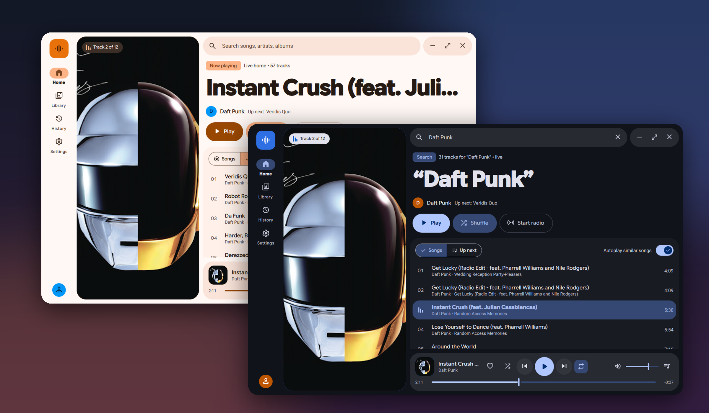
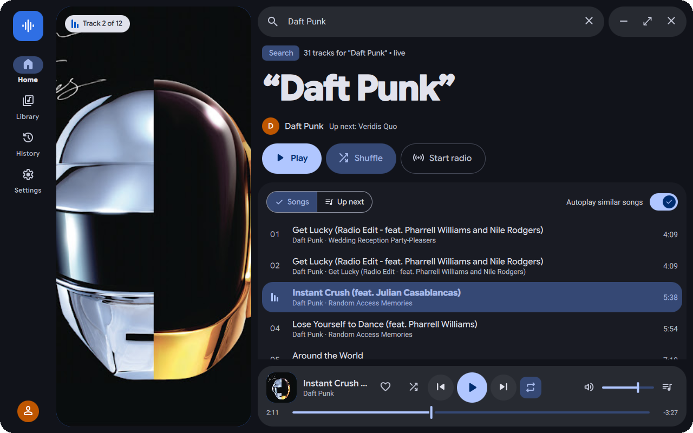
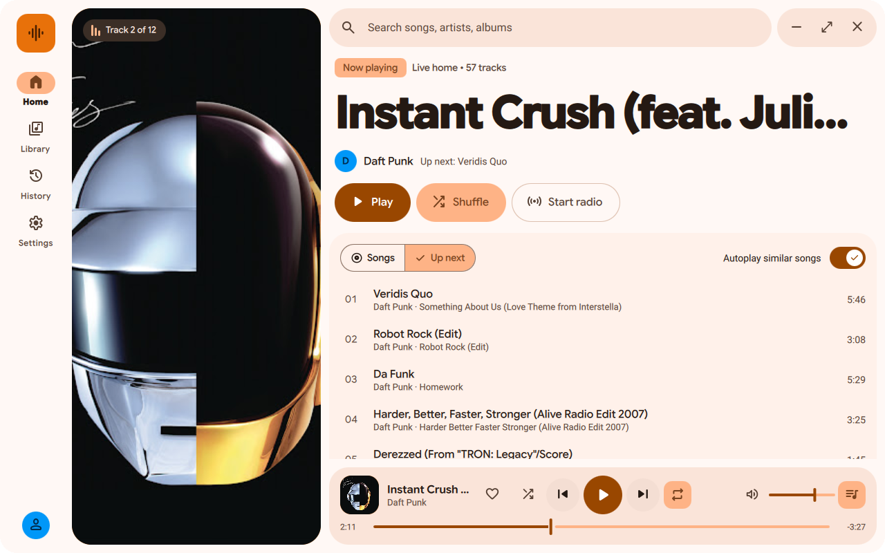
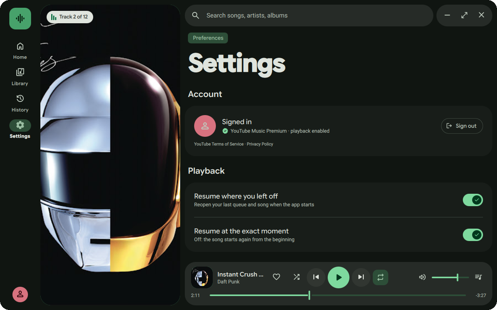
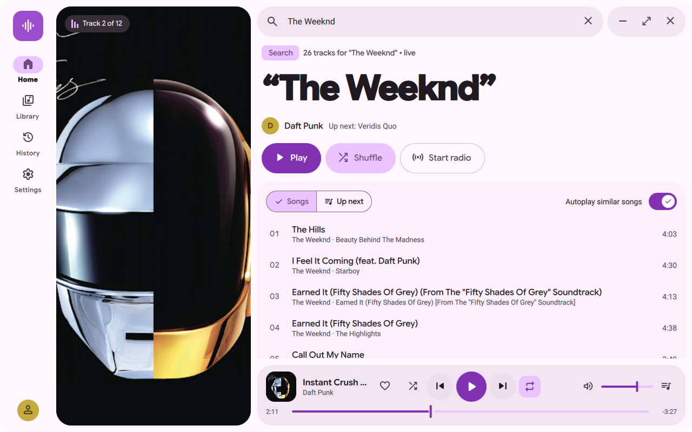

<div align="center">

# Music Player

**A fast, good-looking desktop client for YouTube Music Premium.**<br>
Rust under the hood, a Qt Quick UI in Material 3 Expressive on top.



</div>

## Highlights

- **Material 3 Expressive design.** Shape-morphing buttons, a large art pane, a docked player and the app's own title bar. Five color seeds (Mono, Ember, Ocean, Forest, Orchid), each in light and dark.
- **Opens instantly.** The last sign-in result plus home, library and playlist rows come from a small metadata-only disk cache, so the app is usable before the network answers. Fresh data then replaces it in the background.
- **Picks up where you left off.** Close the app mid-song and it reopens on the same queue, paused at the same second. Both behaviours can be switched off in Settings.
- **Handles big playlists.** Playlists load page by page as you scroll, and the list is virtualized, so even a fully loaded playlist with thousands of songs only draws the rows on screen.
- **Better search.** Merges the signed-in and guest Songs results, then ranks by how well the title matches and by play count. So "Hello" finds Adele first.
- **Your YouTube likes.** Hearts come from your Liked Music, and liking a song here likes it on YouTube Music too.
- **Queue that makes sense.** Playing a row queues the list around it. Shuffle, repeat one/all, radio and autoplay of similar songs are all there, and the next track is prefetched so Next is instant.

<table>
<tr>
<td></td>
<td></td>
</tr>
<tr>
<td></td>
<td></td>
</tr>
</table>

## Privacy and fair use

- **Requires YouTube Music Premium.** Playback is gated on a verified Premium account. The app never removes, skips or blocks ads.
- **Streams only.** Nothing is downloaded, saved or exported. Stream URLs live in memory only and are never logged or written to disk.
- **Secrets stay in your OS keyring.** Sign-in happens in a separate browser window, so your password never touches the app. The resulting session cookie goes straight to the system keyring, and logs are redacted.
- **Cache is metadata only.** `~/.cache/music-player/` holds titles, ids and artwork links. Settings live in `~/.config/music-player/`.

This is an unofficial client and is not affiliated with or endorsed by Google or YouTube.

## Building

Linux for now; other platforms are planned.

**Requirements**

- Rust (stable) and **Qt 6.11** with `qmake6` on your `PATH` (bindings via [QtBridge](https://crates.io/crates/qtbridge))
- ALSA/PipeWire audio (playback uses `rodio`)
- A Secret Service keyring (GNOME Keyring, KWallet, …)
- For browser sign-in: `python3-gobject` and `webkit2gtk4.1`. Without them, the app falls back to pasting a cookie header.
- Fonts: [Material Symbols Rounded](https://fonts.google.com/icons), [Google Sans Flex](https://fonts.google.com/specimen/Google+Sans+Flex) and [Roboto](https://fonts.google.com/specimen/Roboto). Put them in `~/.local/share/fonts/music-player/` and run `fc-cache -f`; without them, icons show up as words.

**Build and run**

```sh
cargo run --release
```

**Checks**

```sh
cargo test
cargo clippy --all-targets -- -D warnings
```

## How it's put together

- `src/`: all logic in Rust.
  - Sign-in and keyring (`auth/`), the Premium check (`premium_gate.rs`) and streaming plus the queue (`playback/`).
  - YouTube Music home, search and library (`ytmusic/`), list models (`models/`) and theme generation (`theme.rs`).
  - The disk cache (`disk_cache.rs`) and preferences (`prefs.rs`).
- `qml/`: thin Qt Quick views and small Material 3 parts (`IconButton`, `PillButton`, `Segmented`, `Toggle`, …). Colors only come from the Rust `Theme`.

Playback uses YouTube's InnerTube player API. Audio is fetched in 256 KiB ranges, held in memory only and decoded by `rodio`.
